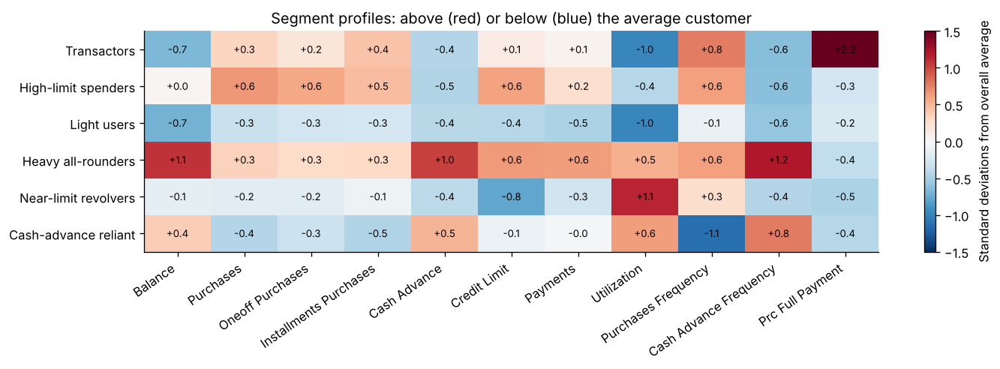
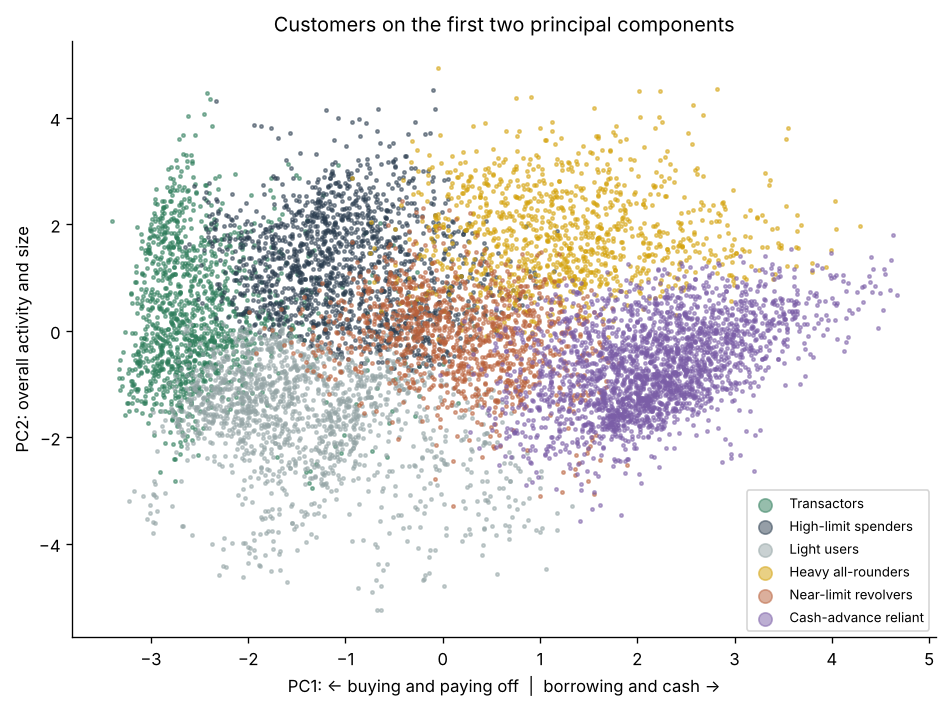
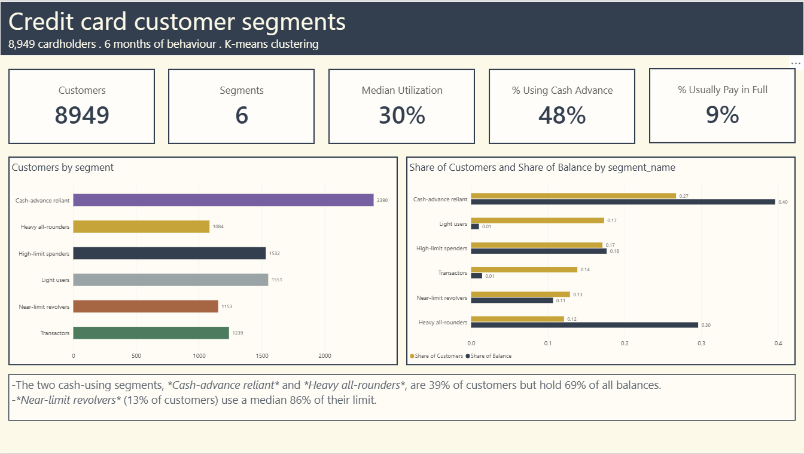

# Credit Card Customer Segmentation (K-Means + Power BI)

Grouping 8,949 credit card holders into six behavioural segments with **K-means clustering** in Python, and delivering them to business users through an **interactive Power BI report**. Each segment gets a persona, a suggested action and a risk view, so marketing, product and risk teams can treat customers differently.

**▶ Power BI report: [PDF export](powerbi/credit_card_segments.pdf)** · [Notebook](notebooks/credit_card_segmentation_kmeans.ipynb) · [Power BI build guide](powerbi/POWERBI_BUILD_GUIDE.md)



## Business problem

A card issuer that treats every cardholder the same misses the point: a customer who pays in full every month and one who withdraws cash at the limit need very different offers, reminders and credit reviews. Segmentation groups customers by how they actually use the card, so each group can be served, and watched, appropriately.

## Data

[Credit Card Dataset for Clustering](https://www.kaggle.com/datasets/arjunbhasin2013/ccdata) (Kaggle): 8,950 active cardholders, 18 behavioural columns summarising 6 months of use (balances, purchases, cash advances, payments, limits, frequencies). The currency isn't stated; amounts are treated as US dollars.

## Approach

1. **Data quality:** 1 row without a credit limit dropped; cash-advance frequency capped at 1 (8 values were up to 1.5); 313 missing minimum payments left as missing, since the column isn't used for clustering.
2. **Feature selection:** 10 features, one per dimension of card behaviour, without near-duplicates: balance, one-off and instalment purchases, cash advances, credit limit, payments, purchase frequency, cash-advance frequency, full-payment rate, and **utilization** (balance ÷ limit, engineered).
3. **Transformation:** log(1 + x) on the six amounts (skewness fell from up to 10 to under 2), then standardisation, so no feature dominates the distances.
4. **Choosing k:** elbow and silhouette for k = 2–10, with the silhouette worked by hand for one customer. Neither method gives a clear answer (silhouette ≈ 0.22–0.25 throughout), so k was chosen on business usefulness, then checked for stability.
5. **Stability:** re-running on 5 different random starts and on 5 random 80% subsets reproduces the segments (adjusted Rand index 0.97–1.00).
6. **Interpretation:** rule-based naming from segment medians; z-score profile heatmap; PCA to visualise.
7. **Delivery:** a star schema exported for Power BI, plus a theme, DAX measures and a page-by-page build guide.

## The six segments

| Segment | Customers | Share of balances | What they do | Suggested action | Risk view |
|---|---|---|---|---|---|
| **Transactors** | 14% | 1% | Buy often, pay in full almost every month | Rewards and premium upgrades | Low |
| **High-limit spenders** | 17% | 18% | High limits, largest purchases, low utilization | Spend-based offers, instalment plans, retention | Low to moderate |
| **Light users** | 17% | 1% | Small balances, occasional purchases | Activation campaigns; review dormant accounts | Low |
| **Heavy all-rounders** | 12% | 30% | Highest balances: buy, take cash and revolve | Balance-transfer and instalment offers; close monitoring | Moderate to high |
| **Near-limit revolvers** | 13% | 11% | Low limits used almost fully (median 86%) | Early-warning monitoring; review before limit increases | High |
| **Cash-advance reliant** | 27% | 40% | Rarely buy; withdraw cash at high interest | Offer lower-cost credit; watch for financial stress | High |

**Headline:** the two cash-using segments are **39% of customers but hold 69% of all balances**.



## Key decisions and findings

- **No natural clusters, and that's normal.** The silhouette score is low and flat from 3 to 10 segments: customers sit on a continuum. The statistics narrow the options (more than 6 segments produces tiny groups of about 260 customers); the business use decides.
- **Why six, not five.** The silhouette score is fractionally higher at five, but the five-segment solution merges most *near-limit revolvers* (86% median utilization) into a group whose other members use just 21% of their limit. For a risk team, that's the group most worth seeing separately.
- **Fuzzy edges, stable cores.** The low silhouette says boundaries are fuzzy; the high stability says the segments themselves are consistent. The export includes each customer's distance to their segment centre, so atypical customers can be flagged.
- **PCA, read properly:** the first component contrasts *borrowing and cash* with *buying and paying off*; the second is *overall activity and size*. Together they keep 56% of the variation.

## Power BI report

Built from `powerbi/data/` using the [build guide](powerbi/POWERBI_BUILD_GUIDE.md).

| Page | What it shows |
|---|---|
| Overview | KPIs; customers by segment; share of customers vs share of balances |
| Segment profiles | Heatmap matrix of z-scores: how each segment differs from the average customer |
| Segment explorer | PCA scatter, utilization distribution and least-typical customers, filtered by segment |
| Personas & actions | Persona, suggested action and risk view for the selected segment, compared with all customers |
| Method | Choosing k, stability and limitations |

<!-- After building the report, add your screenshots here, e.g.:


-->

**Data model:** a star schema. The `customers` fact table and the `segment_profile` table both link to the `segments` dimension; `segment_profile` also links to `metrics`.

## Limitations

- One six-month snapshot from one unnamed issuer, with no dates, so segment movement over time can't be studied yet.
- No outcome data (profit, defaults, churn): the risk views and actions are hypotheses to test.
- Segment boundaries are fuzzy; the feature list and transformations shape the result, and are documented so they can be challenged.

## Model ownership

In production I'd re-assign customers to the existing segment centres monthly and refit the model less often (e.g. yearly), so segments stay comparable over time. I'd monitor segment sizes, migration between segments and input drift; validate the segments against outcomes once available; and check that actions taken per segment (for example, limit decisions for near-limit revolvers) don't disadvantage protected groups.

## Project structure

```
├── notebooks/
│   └── credit_card_segmentation_kmeans.ipynb   # Full analysis, commented step by step
├── src/segmentation.py         # Same logic as a module; regenerates the Power BI tables
├── powerbi/
│   ├── data/                   # Star-schema tables for Power BI (written by the notebook)
│   ├── DataKritii_theme.json   # Report theme
│   ├── measures.dax            # All DAX measures, with formats
│   └── POWERBI_BUILD_GUIDE.md  # Page-by-page build instructions
├── tests/test_segmentation.py  # Automated checks
├── data/CC GENERAL.csv
├── reports/figures/
└── requirements.txt
```

## How to run

```bash
git clone https://github.com/DataKritii/credit-card-customer-segmentation.git
cd credit-card-customer-segmentation
pip install -r requirements.txt

jupyter notebook                 # the analysis notebook (writes powerbi/data/)
python -m src.segmentation       # or regenerate the Power BI tables without the notebook
pytest tests/                    # the automated tests
```

## Tech stack

Python · pandas · scikit-learn · matplotlib · Power BI (DAX, star schema) · pytest
